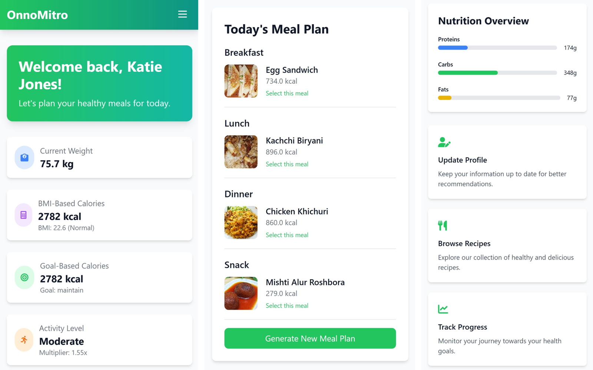
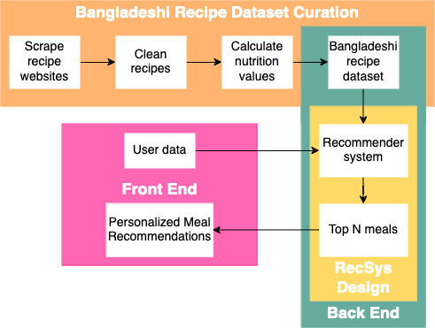
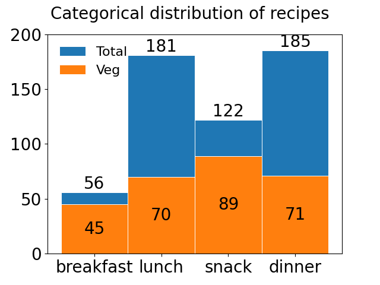

# OnnoMitro: Personalized Bangladeshi Meal Recommendations

**OnnoMitro** is a web application that recommends personalized daily meals from **traditional Bangladeshi cuisine**. It is built on a **novel dataset of 305 Bangladeshi recipes** with per-serving nutrition, and matches recipes to each user's energy and macronutrient needs. On 50 test users, its daily recommendations differ from the target calorie intake by a **median of 22 kcal** (mean absolute error 85.84 kcal).

Senior Design Project (CSE 499), Department of Electrical and Computer Engineering, North South University · 2024
Shahariar Ifti, Tasin Tayeba Khan, Moshiur Rahman · Supervised by Dr. Sifat Momen



## Why
Most meal recommendation systems are built on Western datasets, so their suggestions are hard to follow in countries with very different food habits, such as Bangladesh. OnnoMitro ("onno" means food in Bangla, "mitro" means friend) starts from the dishes people in Bangladesh actually cook and eat.

## How it works



**1. A new Bangladeshi meal dataset**
- Recipes collected by web scraping from three Bangladeshi recipe websites (Banglar Rannaghor, BDFoodRecipe and Vegan Bangla), then cleaned
- Each recipe tagged by meal type (breakfast, lunch, snack, dinner) and as vegetarian or not
- Calories, carbohydrate, protein, fat and fiber per serving calculated with the Edamam Nutrition Analysis API
- Result: 305 recipes with 17 attributes, in `recipes_final.csv`



**2. Recommender system**
- Estimates the user's daily energy needs from basal metabolic rate (height, weight, age, sex) and physical activity level, then adjusts for BMI and the user's goal (lose, maintain or gain weight)
- Splits the target into macronutrients: 50% carbohydrate, 25% protein, 25% fat, plus 25 g of fiber per day
- Filters recipes by meal type and vegetarian preference, scores each by its weighted difference from the nutrient targets (calories weighted most), and recommends the closest matches

**3. Web application**
- Sign-up and profile (age, sex, height, weight, activity level, goal, dietary preference)
- Dashboard with BMI-based and goal-based calorie targets and today's meal plan
- Alternative suggestions for any meal, recipe details with nutrition, and remaining-calorie tracking
- Admin dashboard to add, edit and delete recipes

## Results
To evaluate the recommender, we created 50 synthetic user profiles with values typical of the Bangladeshi population and compared each user's recommended daily calories with their goal-based calorie target.

| Metric | Value |
|---|---|
| Mean absolute error | 85.84 kcal/day |
| Median absolute error | 22 kcal/day |

Errors are small for users aiming to lose or maintain weight. The largest errors come from the uncommon case of users with normal or high BMI who want to gain weight, which pulls the mean above the median.

## Tech stack
**Back end:** Python, Flask, Flask-SQLAlchemy, Flask-Migrate, MySQL, pandas
**Front end:** HTML, Tailwind CSS, JavaScript, Jinja templates (with dark mode)
**Dataset:** Beautiful Soup, requests, pandas, Edamam Nutrition Analysis API

## Repository structure
```
app.py                  Flask app: authentication, profile, meal plans, recipes, admin
models.py               Database models (User, Recipe, Admin, dietary preferences)
backend/
  recommendation.py     Nutrition targets and recipe ranking
templates/              Page templates (dashboard, recommendations, recipes, admin...)
frontend/, static/      CSS and JavaScript
recipes_final.csv       The Bangladeshi meal dataset (305 recipes)
import_recipes.py       Loads recipes into the database
database.sql            MySQL schema
migrations/             Database migrations
docs/feature_ideas.md   Ideas for future versions
```

## How to run
Requires Python 3.8+ and a local MySQL server.

```bash
git clone https://github.com/Sh-Ifti/onnomitro-meal-recommender.git
cd onnomitro-meal-recommender
pip install -r requirements.txt

# Create the database (the app expects one named diet_database)
mysql -u root -e "CREATE DATABASE diet_database"
mysql -u root diet_database < database.sql

python app.py
```
Then open http://127.0.0.1:5000. Database credentials are set in `app.py` (`SQLALCHEMY_DATABASE_URI`).

> This is an academic prototype for local use. Before any public deployment it needs a secret key from an environment variable and the default admin account removed.

## Future work
A cross-platform mobile app with Bangla language support, and using the app to study dietary trends among Bangladeshi users.

## Acknowledgements
Recipes were collected from [Banglar Rannaghor](https://www.banglarrannaghor.com/), [BDFoodRecipe](https://bdfoodrecipe.com/) and [Vegan Bangla](https://veganbangla.com/); recipe text and images belong to their original authors. Nutrition values were calculated with the [Edamam Nutrition Analysis API](https://www.edamam.com/).

## License
Code is released under the MIT License (see `LICENSE`).
